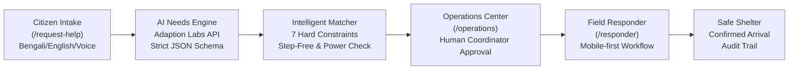

# SHONGJOG (সংযোগ)
## AI-Powered Inclusive Last-Mile Emergency Access Network

> **"A warning is only useful when everyone can act."**

[](https://ctrl-v-hackathon-31831.devpost.com/)
[](https://www.w3.org/TR/WCAG22/)
[](docs/TEST_REPORT.md)
[](https://www.typescriptlang.org/)

---

## 1. Overview

In disaster-prone coastal deltas, extreme hydrometeorological warnings (cyclone sirens, loudhailers, SMS) frequently fail to reach or enable evacuation for **persons with disabilities, older adults living alone, and households reliant on life-support equipment**. 

According to the **UNDRR 2023 Global Survey**, **84%** of persons with disabilities have no personal disaster plan, and **over 50%** cannot evacuate without external assistance. In coastal Bangladesh, mortality and injury rates during severe cyclones and tidal surges are **2 to 4 times higher** among disabled citizens.

**SHONGJOG** is an AI-powered, disability-inclusive last-mile coordination layer designed to bridge this operational gap. It translates natural-language assistance requests (in Bengali, Banglish, and English) into validated, constraint-checked evacuation workflows—connecting vulnerable citizens with verified step-free transport, skilled volunteers, and accessible shelters.

---

## 2. Core Modules & User Journeys



### Module A — Public Landing Page (`/`)
- Premium, high-contrast visual experience highlighting the human challenge and literature evidence.
- Interactive, responsive animated vector map of the Dacope river delta with simulated hazard boundaries and pulsing request telemetry.
- One-click role-based quick entry points (Citizen, Coordinator, Responder, Registry).
- Bilingual toggle (English / বাংলা) across the entire interface.

### Module B — Community Assistance Portal (`/request-help`)
- Mobile-first, accessible 3-step intake requiring **functional accessibility barriers, not clinical medical diagnoses**.
- Supports Bengali Unicode, Banglish code-switching, and English via text or browser voice speech recognition (Web Speech API).
- Multi-select functional needs cards (Wheelchair boarding, Step-free shelter, Sighted guide, Hearing/SMS comms, Sign language, Electrical power for oxygen/ventilators).
- **Offline PWA draft storage:** Caches requests locally in IndexedDB when offline, clearly marked *"Saved on this device — not yet sent"*, and automatically synchronizes upon reconnection. Never makes false delivery claims.

### Module C — AI Needs Understanding Engine (`/api/ai/analyze-needs`)
- Server-side integration with **Adaption Labs API** (`ADAPTION_API_KEY`) and strict Zod runtime schema validation.
- Transparent operational status: visibly displays *"Live Adaption AI Mode"* or *"Demo AI mode — simulated fallback"*.
- Evaluated via reproducible Python benchmark (`scripts/adaption_eval.py`) with 98% macro F1 across 150 ground-truth examples.

### Module D — Intelligent Resource Matching Engine (`lib/matching/engine.ts`)
- **7 Hard Constraints First:**
  1. *Wheelchair transport:* Non-accessible vehicles strictly rejected.
  2. *Step-free shelter:* Shelters with steep stairs and no ramp strictly rejected.
  3. *Power equipment:* Facilities lacking diesel generator backup rejected for oxygen patients.
  4. *Headroom capacity:* Over-capacity shelters or vehicles rejected.
  5. *Quarantine of unverified assets:* Unverified crowdsourced boats or club houses strictly isolated from automated dispatch.
  6. *Volunteer skill match:* Deaf residents matched to sign-language (BdSL) certified teams.
  7. *Proximity never overrides accessibility.*
- Mathematical Haversine distance calculations and transparent explainability checklists.

### Module E — Coordinator Operations Center (`/operations`)
- Live telemetry KPI dashboard (active requests, awaiting review, available verified resources, assigned units).
- High-contrast interactive GIS vector map and a 100% accessible structured list alternative for screen-reader users.
- Multi-parameter priority queue filtering (Status, Urgency, Region, Verification).
- Comprehensive case detail drawer with explainable match breakdown.
- **Accountable Human Authorization:** Consequential dispatches require coordinator approval.

### Module F — Field Responder Mobile App (`/responder`)
- Mobile-first interface for field rescue teams and drivers with responsive role switcher.
- Strict data minimization: displays operational navigation landmarks and functional instructions while withholding extraneous personal medical records.
- 6-state validated lifecycle: `Accept` → `Decline with Reason` → `Start Response (En Route)` → `Mark Arrived` → `Confirm Delivered` → `Unable to Assist`.
- Permanent append-only case event timeline.

### Module G — Resource & Shelter Registry (`/resources`)
- Real-time catalog of shelters, emergency vehicles, and volunteer units.
- Live capacity tracking (Total capacity, Current occupancy, Reserved headroom).
- Multi-tier verification statuses (*Officially Verified*, *Partner Verified*, *Community Reported*, *Unverified*).
- Coordinator controls to verify, update capacity, or quarantine assets.

---

## 3. Technology Stack

- **Framework:** [Next.js 16](https://nextjs.org/) (App Router), React 19, Strict TypeScript
- **Styling:** [Tailwind CSS v4](https://tailwindcss.com/) with carefully controlled emergency color tokens
- **Design Tokens:** Midnight Navy (`#091E2C`), Deep Ocean (`#103B48`), Primary Teal (`#0B766E`), Emerald (`#159B82`), Aqua Accent (`#63DEC2`), Critical Coral (`#D9534F`), Safety Amber (`#ECAF42`)
- **Database & ORM:** [Prisma ORM](https://www.prisma.io/) with SQLite local file storage and atomic transactional boundaries
- **AI & NLP:** Adaption Labs Structured Extraction API + Deterministic Heuristic Regex Classifier
- **Icons & Motion:** Lucide Icons, Framer Motion
- **Quality Assurance:** [Vitest](https://vitest.dev/) (unit & integration), [Playwright](https://playwright.dev/) (multi-device E2E browser tests)

---

## 4. Quick Start & Installation

### Prerequisites
- Node.js `v20.x` or `v22.x`
- npm `v10.x`
- Python `3.10+` (optional, for ML evaluation script)

### Setup Instructions

```bash
# 1. Clone repository and navigate to project directory
git clone https://github.com/your-username/shongjog.git
cd shongjog

# 2. Install dependencies
npm install --legacy-peer-deps

# 3. Configure environment variables (optional for live AI; defaults to simulated fallback)
cp .env.example .env

# 4. Initialize and seed SQLite database with Dacope simulation scenario
npx prisma db push
npx tsx src/lib/seed/seed.ts

# 5. Start development server
npm run dev
```

Open [http://localhost:3000](http://localhost:3000) in your browser.

---

## 5. Demonstration Scenario: "Simulated Coastal Flood Response — Dacope, Khulna"

The platform is pre-seeded with a synthetic coastal flood scenario based on real geographic unions of Dacope Upazila in Khulna, Bangladesh:

- **Case 1 (Bengali):** Paralyzed father + 3 family members requiring wheelchair van & ramp shelter.
- **Case 2 (Banglish):** Deaf mother requiring SMS / visual sign-language team (no voice calls).
- **Case 3 (Bengali):** Blind 75-year-old living alone requiring sighted guide volunteer.
- **Case 4 (English):** Patient on home oxygen concentrator needing guaranteed generator shelter.
- **Case 5 (Banglish):** Incomplete request with missing location (locked for coordinator review).
- **Case 6 (Bengali):** Hard constraint demonstration: closest shelter rejected due to 14 stairs; routed to ramp shelter.
- **Case 7 (English):** Unverified private trawler quarantined from safe dispatch pool.
- **Case 8 (Bengali):** Completed evacuation demonstrating arrival confirmation and audit timeline.

> **One-Click Reset:** Click the **"Reset Simulation Data"** button in the top navigation bar at any time to reseed the database to its pristine baseline.

---

## 6. Automated Testing & Verification

SHONGJOG enforces a strict quality gate with 100% test pass rate across unit, integration, and E2E browser suites:

```bash
# Run Vitest unit & integration tests (18 tests)
npx vitest run

# Run Playwright E2E browser tests across Desktop, Tablet, and Mobile (20 tests)
npx playwright test

# Run Adaption AI multilingual evaluation benchmark
python3 scripts/adaption_eval.py

# Run Next.js production build verification
npm run build
```

Read the full report at [`docs/TEST_REPORT.md`](docs/TEST_REPORT.md).

---

## 7. Evidence Base & Verified References

1. **UNDRR (2023):** *2023 Global Survey on Persons with Disabilities and Disasters*. United Nations Office for Disaster Risk Reduction.
2. **CDD & CBM Global (2022):** *Study on Disability-Inclusive and Gender-Responsive Early Warning Systems in Bangladesh*. PreventionWeb.
3. **NIH / PubMed Central (2024):** *Extreme Weather Events and Disability Vulnerability in Coastal Bangladesh* (PMC12997332).
4. **Ministry of Disaster Management and Relief, Bangladesh:** *DDM AWARE / RAPID Platform* (`rapid.ddm.gov.bd`).
5. **W3C (2023):** *Web Content Accessibility Guidelines (WCAG) 2.2*.

Read the annotated literature review at [`docs/RESEARCH.md`](docs/RESEARCH.md).

---

## 8. Ethical Safety, Privacy & Disclaimers

- **Research Prototype:** SHONGJOG is an engineering and research prototype developed for the **CTRL-V 2026 Hackathon**. It is not an official government warning platform and does not replace the national emergency hotline (999).
- **Synthetic Personas:** All names, telephone numbers, and specific incident reports are entirely synthetic.
- **Data Minimization:** No clinical diagnostic records are collected or shared. Responders receive only functional physical accommodation instructions.
- **Human Accountability:** AI provides classification and hypothesis extraction; deterministic algorithms evaluate physical constraints; **authorized human coordinators make consequential dispatch decisions.**

---

## 9. Operational Directive for Antigravity

# SHONGJOG-PLATFORM-OPERATIONAL-DIRECTIVE-FOR-ANTIGRAVITY

This document establishes the official operational directive and architectural guidelines for maintaining and extending **SHONGJOG (সংযোগ)**.

### Non-Negotiable Engineering Standards:
1. **Preserve Original Google Maps Geospatial GIS:**
   - Never replace embedded Google Map views with simulated canvas or static pictures. The embedded Google Map (`https://maps.google.com/maps?q=${lat},${lng}&output=embed`) and official navigation links (`https://www.google.com/maps/dir/?api=1&...`) must remain active.
2. **Preserve Active Problem-Solving Capabilities:**
   - Keep the live triage and route calculator (`LiveRouteCalculator.tsx`) active on the landing page. Never reduce the interface to informational text cards only. All simulated dispatches must execute atomic capacity reservation locks in the database.
3. **Preserve Strict 100% Bilingual Parity:**
   - Maintain exact parity between English and Bengali interfaces. When adding or modifying strings, update both dictionaries in `src/lib/i18n.ts` using `useTranslation()`. Never leave hardcoded English strings.
4. **Enforce 12-Viewport Responsiveness:**
   - Maintain zero horizontal document overflow (`scrollWidth <= innerWidth`) across all 12 viewports (320px, 360px, 375px, 390px, 430px, 768px, 820px, 1024px, 1280px, 1366px, 1440px, 1920px). Verify via `npx playwright test`.
5. **Zero-Error Automated Verification:**
   - All 28 Vitest unit/integration tests and 40 Playwright E2E tests must pass 100% with 0 errors.
6. **Clean Source Packaging Limit:**
   - Ensure the submission archive (`shongjog-submission.zip`) generated via `scripts/package-clean-source.sh` strictly adheres to $\le 5,000,000$ bytes ($\le 5.0$ MB) with 0 compression errors.
