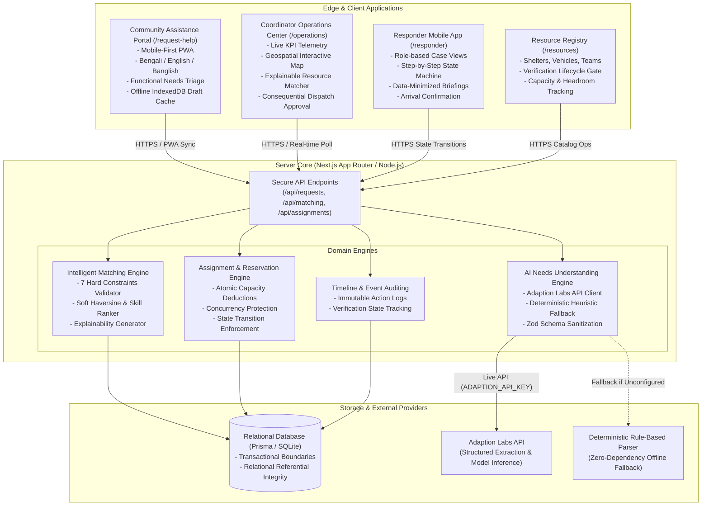
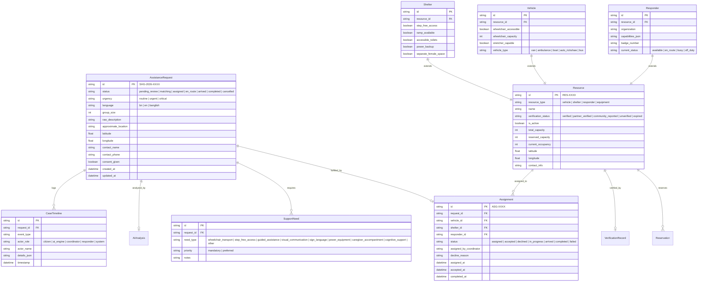
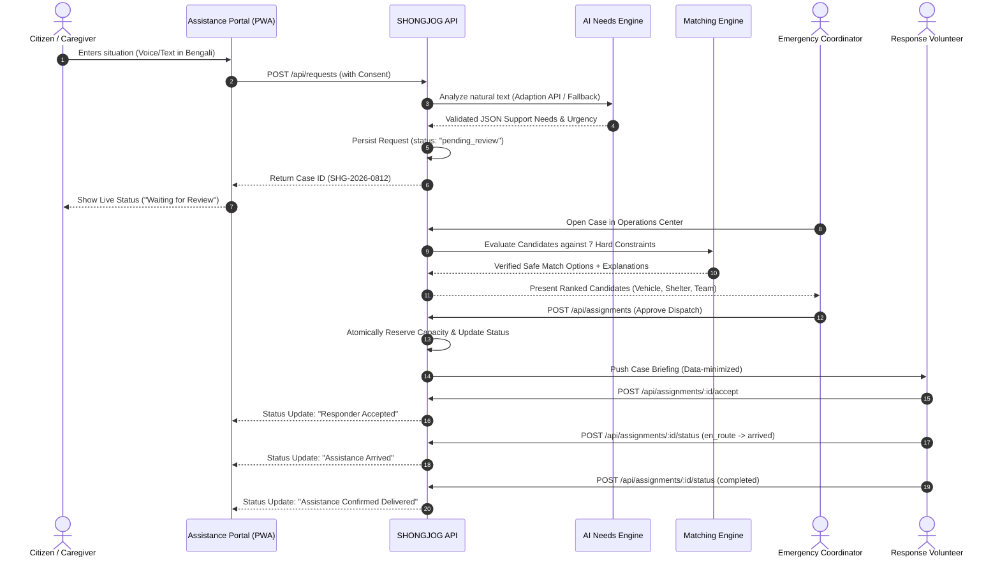

# SHONGJOG — System Architecture & Technical Specification
## AI-Powered Inclusive Last-Mile Emergency Access Network
**Version:** 1.0 (March 2026)  
**Hackathon:** CTRL-V 2026

---

## 1. High-Level Architecture Overview

SHONGJOG operates as an accessibility and resource-coordination layer that complements national disaster management platforms (such as Bangladesh DDM AWARE) by solving the **last-mile evacuation assistance gap** for persons with disabilities and older adults.

---

## 2. Core Architectural Principles

1. **Functional Barriers Over Clinical Labels:**
   We never mandate medical diagnosis or clinical classification. The system captures functional access requirements: *wheelchair step-free, guided visual navigation, visual/textual communication, sign-language, continuous electrical life-support*.
2. **Hard Constraints Before Soft Optimization:**
   In emergency logistics, physical barriers are absolute. Proximity cannot compensate for an inaccessible facility or vehicle. Hard accessibility constraints filter out incompatible resources before soft distance scoring occurs.
3. **Accountable Human Authorization:**
   AI never autonomously dispatches physical units. AI parses ambiguous language into a validated structural hypothesis; mathematical algorithms verify physical constraints; but an accountable human emergency coordinator reviews and authorizes assignments.
4. **Data Minimization & Selective Disclosure:**
   Responders receive only operational navigation details (approximate location, group count, specific physical assistance needed). Medical details and extraneous personal contacts are withheld.
5. **Radical Transparency in Offline and Simulated States:**
   When the user is offline, requests are cached locally in IndexedDB and flagged clearly as *"Saved on this device — not yet sent"*. The system never falsely reports that an offline request has reached responders.

---

## 3. Relational Data Models & Entity Relationships

---

## 4. End-to-End Interaction Workflows

### 4.1 Citizen Intake to Confirmed Evacuation

---

## 5. Security, Privacy & Reliability Constraints

1. **Strict Data Minimization:** Private phone numbers and full residential coordinates are accessible only to authenticated coordinators. Field responders receive landmark instructions and functional requirements.
2. **Deterministic Fallbacks:** The platform operates seamlessly regardless of whether `ADAPTION_API_KEY` is present. If absent, the deterministic keyword & rule-based engine activates, and the user interface explicitly displays `"Demo AI mode — simulated fallback"`.
3. **Atomic Concurrency Handling:** SQLite transactions with immediate locks prevent double-booking of vehicles or over-allocation of accessible shelter capacity.
4. **Audited State Transitions:** Responders and coordinators cannot jump status backwards or bypass verification gates. All state mutations are append-only recorded in `CaseTimeline`.
