# SHONGJOG — Database Schema & Data Dictionary (V4)
**Engine:** SQLite (WAL mode) / PostgreSQL-compatible  
**ORM:** Prisma 6.4.1  
**Schema File:** `prisma/schema.prisma`

---

## 1. Entity Relationship Overview

The SHONGJOG relational model models 8 primary entities designed for referential integrity, concurrency control, and auditability:

```mermaid
erDiagram
    AssistanceRequest ||--o{ SupportNeed : has
    AssistanceRequest ||--o| Assignment : fulfilled_by
    AssistanceRequest ||--o{ CaseTimeline : logs
    
    Resource ||--o| VehicleDetail : specifies
    Resource ||--o| ShelterDetail : specifies
    Resource ||--o| ResponderDetail : specifies
    Resource ||--o{ Assignment : assigned_as_veh
    Resource ||--o{ Assignment : assigned_as_shl
    Resource ||--o{ Assignment : assigned_as_rsp

    AssistanceRequest {
        string id PK "SHG-2026-XXXX"
        string status "intake_received | ai_parsed | assigned | en_route | arrived | completed | cancelled"
        string urgency "critical | urgent | routine"
        string language "bn | en | banglish"
        int groupSize "1 to 20"
        string rawDescription
        string approximateLocation
        float latitude
        float longitude
        string contactName
        string contactPhone
        string aiExtractionJson
        datetime createdAt
        datetime updatedAt
    }

    SupportNeed {
        string id PK
        string requestId FK
        string needType "wheelchair_transport | electrical_life_support | step_free_shelter | etc"
    }

    Resource {
        string id PK "RES-SHL-XX / RES-VEH-XX / RES-RSP-XX"
        string resourceType "shelter | vehicle | responder"
        string name
        string verificationStatus "verified | partner_verified | unverified | flagged"
        boolean isActive
        int totalCapacity
        int reservedCapacity
        int currentOccupancy
        float latitude
        float longitude
        string contactInfo
        string notes
        string verificationSource
        datetime lastVerifiedAt
    }

    VehicleDetail {
        string id PK
        string resourceId FK
        string vehicleType "van | boat | ambulance | rickshaw"
        boolean wheelchairAccessible
        int wheelchairCapacity
        boolean stretcherCapable
        string driverName
    }

    ShelterDetail {
        string id PK
        string resourceId FK
        boolean stepFreeAccess
        boolean rampAvailable
        boolean accessibleToilets
        boolean powerBackup
        boolean separateFemaleSpace
        string managerName
    }

    ResponderDetail {
        string id PK
        string resourceId FK
        string organization "Cyclone Preparedness Programme (CPP) | Red Crescent"
        string badgeNumber
        string skillsJson "['first_aid', 'sign_language', 'stretcher_carry']"
        string currentStatus "available | assigned | en_route | off_duty"
    }

    Assignment {
        string id PK "ASG-2026-XXXX"
        string requestId FK
        string vehicleId FK
        string shelterId FK
        string responderId FK
        string status "assigned | accepted | in_progress | arrived | completed | declined | failed"
        string assignedByCoordinator
        string coordinatorNotes
        datetime assignedAt
        datetime acceptedAt
        datetime arrivedAt
        datetime completedAt
        string declineReason
    }

    CaseTimeline {
        string id PK
        string requestId FK
        string eventType "created | parsed | assigned | accepted | en_route | arrived | completed"
        string actorRole "citizen | ai_parser | coordinator | responder"
        string actorName
        datetime timestamp
        string detailsJson
    }
```

---

## 2. Field Specifications & Integrity Constraints

### `AssistanceRequest`
- `id`: Unique identifier formatted as `SHG-2026-XXXX` for human radio dispatch clarity.
- `status`: Finite state machine enforcing progressive case triage.
- `groupSize`: Positive integer representing the total evacuees to reserve space for.
- `rawDescription`: Immutable citizen transcript preserving original colloquial voice/text.

### `Resource`
- `totalCapacity`: Physical ceiling of beds or seats.
- `reservedCapacity`: Incrementally locked during coordinator dispatch; decremented if responder declines.
- `currentOccupancy`: Incrementally marked upon confirmed safe arrival at shelter.
- **Headroom Equation:**
  $$\text{Headroom} = \text{totalCapacity} - \text{reservedCapacity} - \text{currentOccupancy}$$

