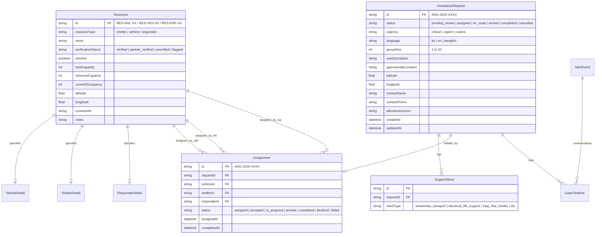

# SHONGJOG (সংযোগ) — Database Schema & Data Dictionary (V4.2.1)
**Database Engine:** Neon Serverless PostgreSQL (`provider = "postgresql"`)  
**ORM:** Prisma ORM 6.4.1  
**Schema File:** `prisma/schema.prisma`  
**Deployment Target:** Vercel Serverless with pgbouncer connection pooling

---

## 1. Entity Relationship Overview

The SHONGJOG relational model comprises 10 primary entities designed for referential integrity, concurrency control, and auditability:



---

## 2. Serverless PostgreSQL Architecture & Concurrency Control

In high-concurrency disaster scenarios, simultaneous coordinators and responders update shared capacities (e.g. shelter beds, wheelchair seating). 

### Atomic Resource Reservation
To guarantee that resources are never over-allocated or assigned beyond capacity, SHONGJOG executes atomic database transactions in PostgreSQL with quoted identifiers:

```typescript
// Atomically deduct and reserve capacity during coordinator approval
const vehicleAffected = await tx.$executeRaw`
  UPDATE "Resource"
  SET "reservedCapacity" = "reservedCapacity" + ${caseReq.groupSize}
  WHERE "id" = ${vehicleId}
    AND "isActive" = true
    AND ("verificationStatus" = 'verified' OR "verificationStatus" = 'partner_verified')
    AND ("totalCapacity" - "reservedCapacity" - "currentOccupancy") >= ${caseReq.groupSize}
`;

if (vehicleAffected === 0) {
  throw new Error("Vehicle capacity exceeded, unverified, or unavailable for reservation.");
}
```

### WAN-Resilient Transaction Timeouts
Because serverless functions communicate with remote PostgreSQL clusters (e.g., AWS us-east-1), interactive transactions configure extended timeouts to prevent premature P2028 closing:

```typescript
await prisma.$transaction(async (tx) => {
  // atomic reservation logic
}, { maxWait: 15000, timeout: 30000 });
```

---

## 3. Migration Management Strategy (Zero Data Loss)

SHONGJOG uses Prisma ORM with Neon Serverless PostgreSQL. 

### Recommended Strategy: `npx prisma db push`
- **Safest Approach:** `npx prisma db push` synchronizes the `schema.prisma` definitions directly to Neon PostgreSQL.
- **Why it is safer than `prisma migrate dev`:** `prisma migrate dev` requires a separate shadow database which is unsupported by serverless pgbouncer poolers and can trigger accidental `Reset database?` prompts that erase live tables.
- **Data Protection:** `prisma db push` safely applies non-destructive schema additions (e.g., adding indexes or optional fields) without wiping table data.

### Strict Operational Directive:
> [!CAUTION]
> **Never run `npx prisma migrate reset` against production Neon PostgreSQL.**
> To re-seed baseline demonstration data safely without altering table structures, use `npx tsx src/lib/seed/seed.ts` or trigger `POST /api/demo/reset`.
