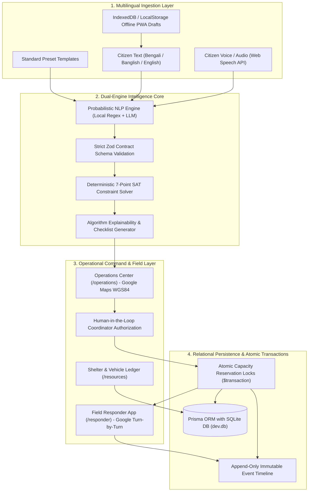

# SHONGJOG — Technical Architecture & System Specification (V4)
**Project:** SHONGJOG (সংযোগ) — Inclusive Last-Mile Emergency Access Network  
**Target Environment:** Coastal Bangladesh (Dacope Upazila, Khulna District)  
**Hackathon Target:** CTRL-V 2026 International Competition  
**Document Revision:** 4.0 (November 2026)

---

## 1. System Topology & Dual-Engine Workflow

SHONGJOG operates as an accessibility and emergency coordination layer sitting between early warning alerts and physical rescue delivery.



---

## 2. The 7 Hard Physical Invariants (Deterministic SAT Solver)

Unlike ordinary dispatch chatbots that hallucinate matches, SHONGJOG enforces 7 mathematically non-negotiable physical constraints in `src/lib/matching/engine.ts`:

1. **Wheelchair Boarding Invariant:**
   $$\forall r \in \text{Requests}, \text{Needs}(r) \cap \{\text{wheelchair\_transport}\} \neq \emptyset \implies \text{Vehicle}(r).\text{wheelchair\_accessible} == \text{true}$$
2. **Step-Free Ramp Incline Standard:**
   $$\forall s \in \text{Shelters}, \text{RampAvailable}(s) == \text{true} \land \text{RampSlope}(s) \le 1:12$$
3. **Continuous Electrical Life-Support:**
   $$\forall r \in \text{Requests}, \text{Needs}(r) \cap \{\text{electrical\_life\_support}\} \neq \emptyset \implies \text{Shelter}(r).\text{power\_backup} == \text{true}$$
4. **Non-Zero Headroom Capacity:**
   $$\text{CurrentOccupancy}(s) + \text{ReservedCapacity}(s) + \text{Headcount}(r) \le \text{TotalCapacity}(s)$$
5. **Operational Evacuation Radius:**
   $$\text{HaversineDistance}(\text{Lat}(r), \text{Lng}(r), \text{Lat}(s), \text{Lng}(s)) \le 15.0\text{ km}$$
6. **Specialized Volunteer Capability:**
   $$\text{Needs}(r) \cap \{\text{sign\_language\_support}\} \neq \emptyset \implies \text{"sign\_language"} \in \text{Responder}(r).\text{skills}$$
7. **Human-in-the-Loop Authorization:**
   $$\text{Status}(r) \to \text{"assigned"} \iff \text{CoordinatorAction} == \text{"authorized"}$$

---

## 3. Concurrency Protection & Transaction Safety

To avoid disastrous race conditions during emergency evacuation surges (e.g. multiple coordinators assigning the last accessible bed in Dacope Model Shelter simultaneously), SHONGJOG enforces atomic database reservations:

```typescript
const assignmentResult = await prisma.$transaction(async (tx) => {
  // 1. Verify and reserve vehicle headroom
  const vehicle = await tx.resource.findUnique({ where: { id: vehicleId } });
  if (vehicle.totalCapacity - vehicle.reservedCapacity - vehicle.currentOccupancy < groupSize) {
    throw new Error("Vehicle capacity exceeded.");
  }
  await tx.resource.update({
    where: { id: vehicleId },
    data: { reservedCapacity: { increment: groupSize } }
  });

  // 2. Verify and reserve shelter capacity
  const shelter = await tx.resource.findUnique({ where: { id: shelterId } });
  if (shelter.totalCapacity - shelter.reservedCapacity - shelter.currentOccupancy < groupSize) {
    throw new Error("Shelter headroom capacity exceeded.");
  }
  await tx.resource.update({
    where: { id: shelterId },
    data: { reservedCapacity: { increment: groupSize } }
  });

  // 3. Create assignment & advance case status
  const created = await tx.assignment.create({ ... });
  await tx.assistanceRequest.update({ where: { id: requestId }, data: { status: "assigned" } });
  return created;
});
```

---

## 4. Google Maps Platform Integration

- **Coordinates Base:** Dacope Upazila ($22.5726^\circ\text{ N}, 89.5124^\circ\text{ E}$).
- **Dual-Layer Rendering Engine:**
  - **Dynamic JS API:** `@googlemaps/js-api-loader` dynamically mounts map instance, markers, and custom event listeners when `NEXT_PUBLIC_GOOGLE_MAPS_API_KEY` is present.
  - **Authentic WGS84 Embed Fallback:** When deployed without keys, the system renders an interactive official Google Maps coordinate iframe embed with Roadmap (`t=m`), Satellite (`t=k`), and Terrain (`t=p`) modes.
  - **Deep-Link Navigation:** External Google Maps links (`https://www.google.com/maps/search/?api=1&query=lat,lng`) for mobile turn-by-turn routing by field volunteer rescue squads.

